

  <picture>
    <source media="(max-width: 640px)" srcset="./assets/profile/mobile/hero.webp">
    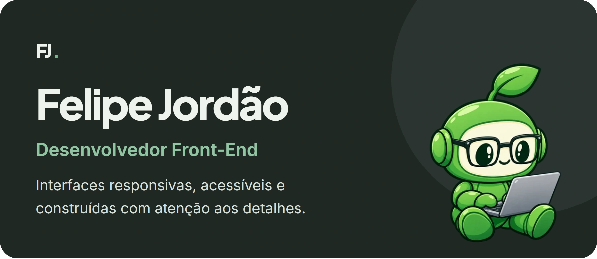
  </picture>

  
  
  

  <picture>
    <source media="(max-width: 640px)" srcset="./assets/profile/mobile/about.webp">
    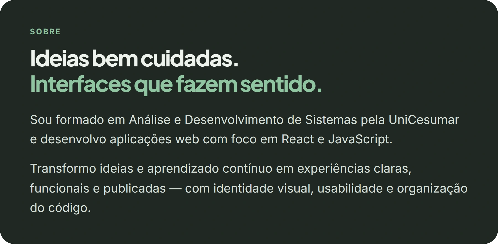
  </picture>

  <picture>
    <source media="(max-width: 640px)" srcset="./assets/profile/mobile/tech.webp">
    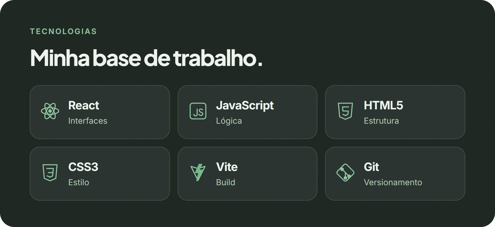
  </picture>

  <picture>
    <source media="(max-width: 640px)" srcset="./assets/profile/mobile/principles.webp">
    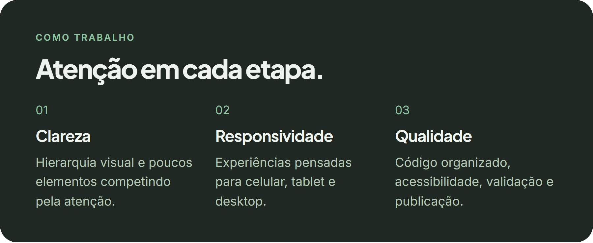
  </picture>

  <picture>
    <source media="(max-width: 640px)" srcset="./assets/profile/mobile/projects.webp">
    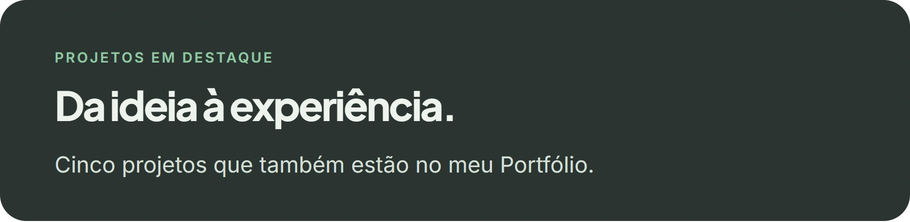
  </picture>

  <a href="https://tela-de-login-jet-seven.vercel.app/"><picture>
    <source media="(max-width: 640px)" srcset="./assets/profile/mobile/login.webp">
    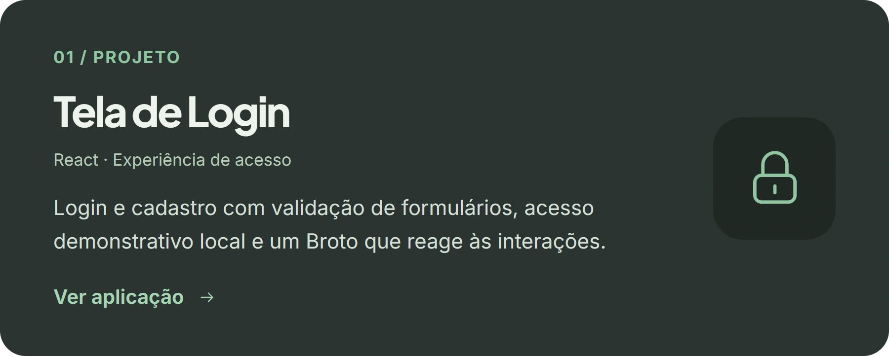
  </picture></a>

  <a href="https://github.com/FelipeJordaoFernandes/tela-de-login">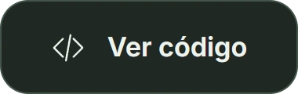</a>

  <a href="https://personal-pokedex.vercel.app/"><picture>
    <source media="(max-width: 640px)" srcset="./assets/profile/mobile/pokedex.webp">
    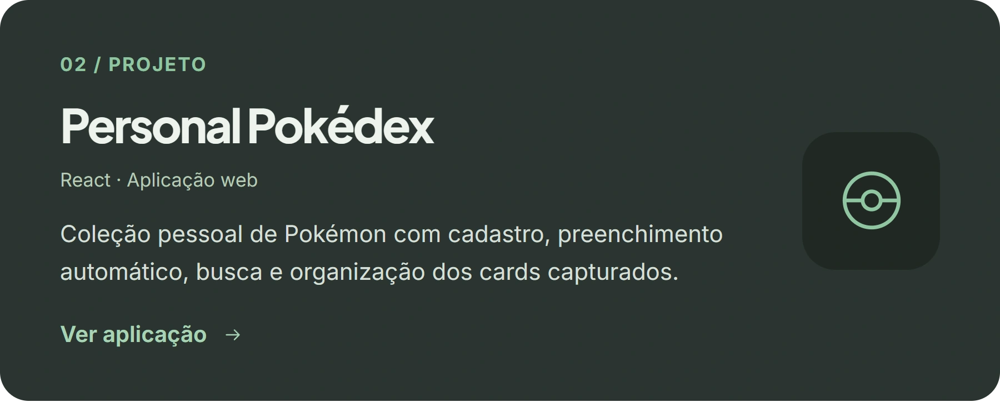
  </picture></a>

  

  <a href="https://to-do-list-seven-lyart-36.vercel.app/"><picture>
    <source media="(max-width: 640px)" srcset="./assets/profile/mobile/todo.webp">
    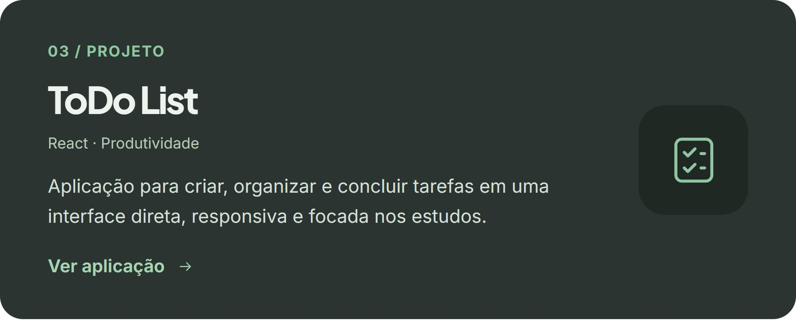
  </picture></a>

  

  <a href="https://eden-androids.vercel.app/"><picture>
    <source media="(max-width: 640px)" srcset="./assets/profile/mobile/eden.webp">
    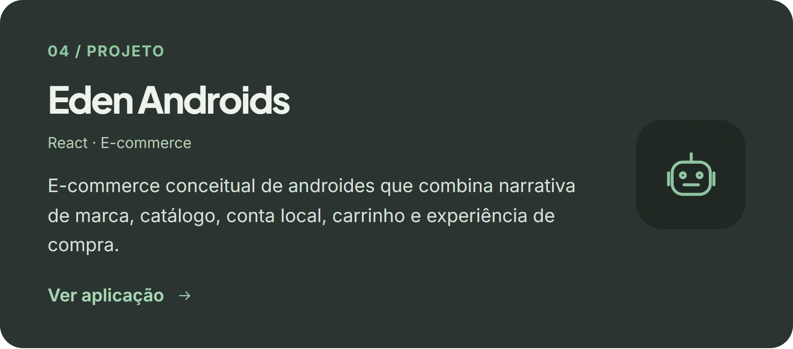
  </picture></a>

  

  <a href="https://cardapio-digital-five-tau.vercel.app/"><picture>
    <source media="(max-width: 640px)" srcset="./assets/profile/mobile/menu.webp">
    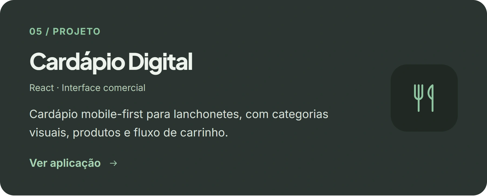
  </picture></a>

  

  <picture>
    <source media="(max-width: 640px)" srcset="./assets/profile/mobile/contact.webp">
    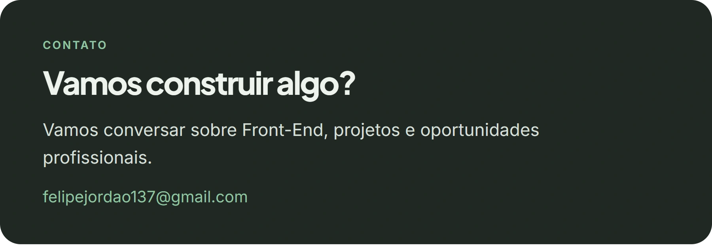
  </picture>

  
  
  

Sobre mim, projetos e contato em texto

### Felipe Jordão

Desenvolvedor Front-End. Interfaces responsivas, acessíveis e construídas com atenção aos detalhes.

### Sobre

Sou formado em Análise e Desenvolvimento de Sistemas pela UniCesumar e desenvolvo aplicações web com foco em React e JavaScript.

Transformo ideias e aprendizado contínuo em experiências claras, funcionais e publicadas — com identidade visual, usabilidade e organização do código.

### Tecnologias

React · JavaScript · HTML5 · CSS3 · Vite · Git

### Como trabalho

- **Clareza:** Hierarquia visual e poucos elementos competindo pela atenção.
- **Responsividade:** Experiências pensadas para celular, tablet e desktop.
- **Qualidade:** Código organizado, acessibilidade, validação e publicação.

### Projetos

#### Tela de Login

React · Experiência de acesso. Login e cadastro com validação de formulários, acesso demonstrativo local e um Broto que reage às interações.

[Ver aplicação](https://tela-de-login-jet-seven.vercel.app/) · [Ver código](https://github.com/FelipeJordaoFernandes/tela-de-login)

#### Personal Pokédex

React · Aplicação web. Coleção pessoal de Pokémon com cadastro, preenchimento automático, busca e organização dos cards capturados.

[Ver aplicação](https://personal-pokedex.vercel.app/) · [Ver código](https://github.com/FelipeJordaoFernandes/personal-pokedex)

#### ToDo List

React · Produtividade. Aplicação para criar, organizar e concluir tarefas em uma interface direta, responsiva e focada nos estudos.

[Ver aplicação](https://to-do-list-seven-lyart-36.vercel.app/) · [Ver código](https://github.com/FelipeJordaoFernandes/ToDo-List)

#### Eden Androids

React · E-commerce. E-commerce conceitual de androides que combina narrativa de marca, catálogo, conta local, carrinho e experiência de compra.

[Ver aplicação](https://eden-androids.vercel.app/) · [Ver código](https://github.com/FelipeJordaoFernandes/eden-androids)

#### Cardápio Digital

React · Interface comercial. Cardápio mobile-first para lanchonetes, com categorias visuais, produtos e fluxo de carrinho.

[Ver aplicação](https://cardapio-digital-five-tau.vercel.app/) · [Ver código](https://github.com/FelipeJordaoFernandes/cardapio-digital)

### Contato

Vamos conversar sobre Front-End, projetos e oportunidades profissionais.

[Portfólio](https://felipe-jordao-portfolio.vercel.app/) · [LinkedIn](https://www.linkedin.com/in/felipe-jordao-fernandes/) · [E-mail](mailto:felipejordao137@gmail.com)

